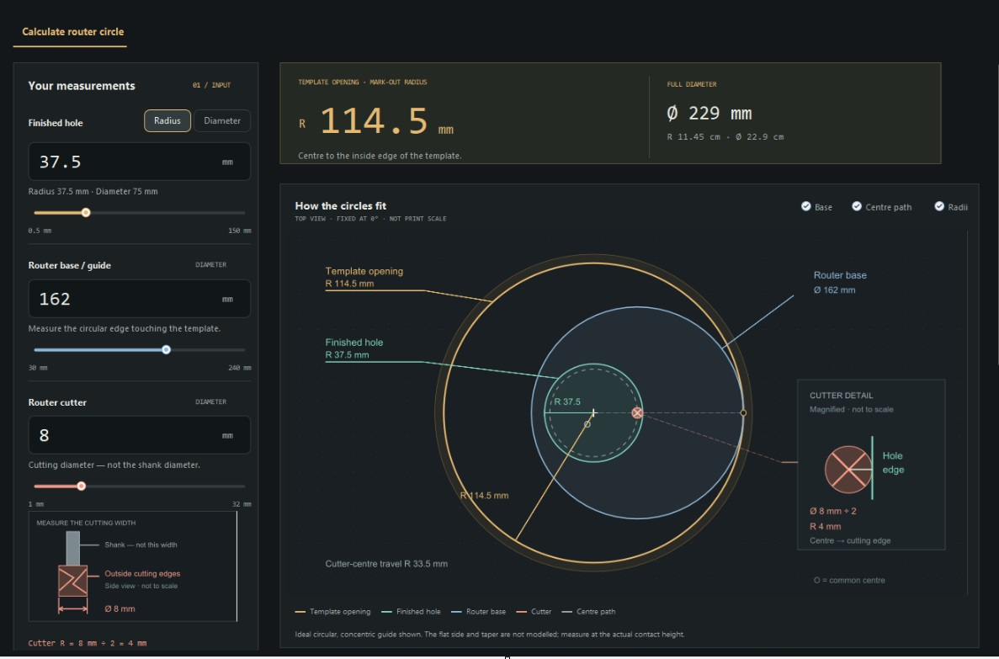
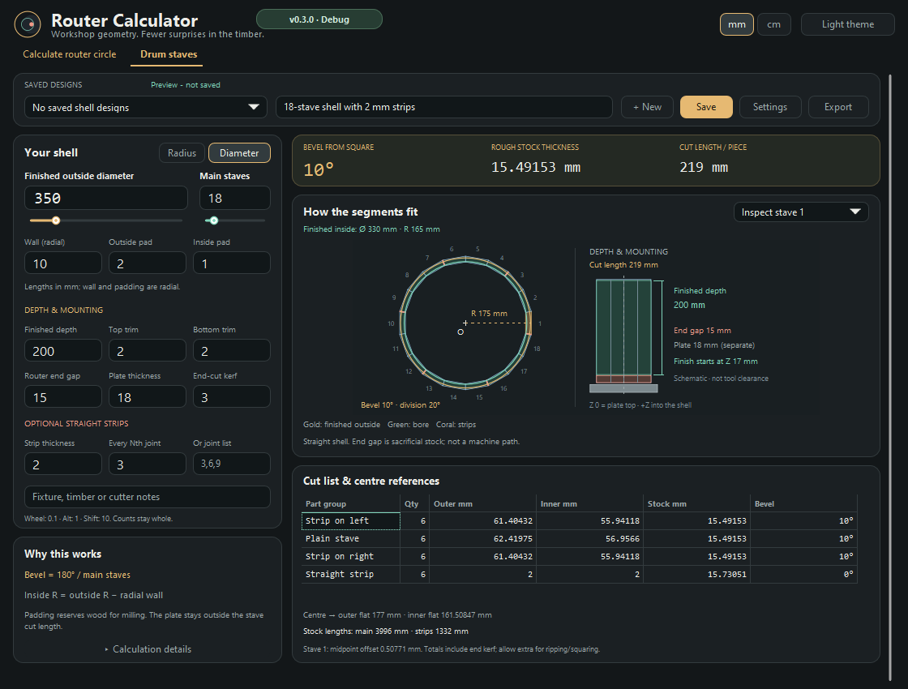

# UPP Router Calculator

Workshop geometry for router templates and stave-built drums. A native U++ / C++ desktop application that shows how the measurements fit together, saves the setups worth keeping, and leaves the arithmetic out of the sawdust.

It started with a small hole and a surprisingly large router base. It now has two calculators, with room in the tab bar for the next useful workshop problem.

*The original circle-view reference supplied during development. The native app now uses a more compact, fixed-height preview and also includes a Drum staves tab.*

## What it does

### Calculate router circle

Enter the finished hole size, the router's circular guide diameter, and the cutter's **cutting diameter**. The calculator returns the inside opening of the template you need, with radius and diameter readings in millimetres and centimetres.

The fixed top view shows the template, hole, guide, cutter and cutter-centre path. A separate cutter sketch points to the cutting edges, rather than the shank, which would be a very tidy way to measure the wrong thing.

### Drum staves

Plan a straight cylindrical shell from its finished outside diameter or radius, number of main staves, final wall thickness and separate inside/outside milling allowances. The app calculates the bevel from square, division angle, rough stock thickness, inner and outer stave widths, and distances from the shell centre.

Optional straight spacer strips can sit at every joint, every Nth joint, or a selected list of joints. Their parallel faces are accounted for by adjusting the adjacent stave widths. The strips do not quietly become extra angular divisions.

Depth, top/bottom trim, mounting-plate thickness and the measured router end gap produce a cut length and an axial sketch. The inaccessible mounting end is treated as sacrificial stock; it does not get borrowed from the finished drum depth. A grouped cut list and numbered exports keep track of the main staves and strips.

*Version 0.3.0, captured from the Debug validation build: saved designs at the top, live sliders, compact mounting inputs, the complete cut list and an explanation that does not require another browser tab.*

## Use it

The latest local release is always **`bin/RouterCalculator.exe`**. Rebuilding replaces that executable, not your saved designs. Debug binaries and compiler caches belong in `build/`; nobody needs a treasure hunt before a test cut.

Choose a tab, enter the measurements, and use the **mm / cm** and **Radius / Diameter** switches as needed. The drum tab starts with outside diameter. **Save**, **Settings** and **Export** keep named designs in ordinary JSON files. `Ctrl+S` saves the active calculator; `Ctrl+O` opens its library. The theme button switches between dark and light.

For a 40 cm drum, put **40 in Outside diameter** with centimetres selected, or type **40cm**. **Wall thickness** is the radial thickness of the timber, not the drum diameter. The finished inside radius and diameter are calculated alongside it. A physically impossible combination highlights the relevant entry and keeps a clearly labelled last valid preview; the drawing does not vanish halfway through a measurement.

The wheel adjusts lengths by **0.1**, **Alt + wheel** by **1**, and **Shift + wheel** by **10**, in the displayed unit. Counts remain whole numbers. Radius/diameter and unit switches stay available while another entry is incomplete.

Version **0.3.0** uses native controls and direct antialiased diagram drawing—no SVG generation. The small green badge at the top identifies the version and **Debug / Release**. Hover over it for the build identifier and the actual executable path; two open copies need not become a small identity crisis. The same identity is available with `--version`.

Both calculators put named designs and **New / Save / Settings / Export** at the top. The drum tab adds outside-size and whole-stave sliders, three-column depth/mounting inputs and **Why this works**. The normal page is 738 logical pixels high, with a fixed shallow preview and a full five-group cut-list area. Extra explanations expand only when opened.

The Release has been compiled into `bin`, but Release runtime/performance verification is still outstanding because of the maintainer's Klick file-access exclusion. Current test and timing evidence—and what it does not establish—are recorded in [Validation](docs/VALIDATION.md) and [Performance](docs/PERFORMANCE.md).

The app runs locally without a browser, account or network connection. Keep it in a writable folder so it can save beside the executable:

| File | Purpose |
| --- | --- |
| `router_calculator.designs.json` | Circle designs and default guide/cutter settings |
| `router_calculator.staves.json` | Drum designs, strips and mounting allowances |
| `router_calculator.preferences.json` | Dark/light preference |

Files are created when needed. Saves keep the previous file as `.bak` and check for external changes before replacing it. Export makes portable copies; keep a backup somewhere other than beside the original.

## Exports and limits

Drum exports include a **CSV cut list**, a **JSON design library**, and **geometry JSON** with numbered parts, cross-section vertices, units and axial references. Geometry is deliberately marked `machineReady: false`: it is not G-code, a robot trajectory, or a collision check.

The drum model is a straight cylinder, not a tapered conga or a compound-bevel vessel. Stock estimates include one separating end-cut kerf per piece, but not initial squaring, ripping waste, defects or board nesting. The mounting plate's diameter and the router's complete physical envelope are not modelled; enter a measured end gap.

The circle model assumes a genuinely circular guide edge centred on the cutter. Flats, taper, an off-centre base, glue-line thickness and real cutting tolerances still need attention. The 162 mm guide default is a provisional workshop measurement, not a certified Bosch specification. Check the actual tool and make a trial assembly or cut. Timber remains notably short of undo buttons.

## Build and extend

Start with [Development](docs/DEVELOPMENT.md) for the U++ setup, build commands, source map and next-tab pattern. [Geometry](docs/GEOMETRY.md) explains the equations and measurement conventions. [Validation](docs/VALIDATION.md) records the checked build and test evidence.

The source and original design references are kept separate. `RouterCalculater/` is the existing U++ package name; its spelling is retained so established assemblies still open it.

Licensed under the [GNU General Public License v3](LICENSE).
